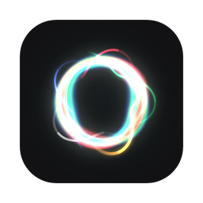
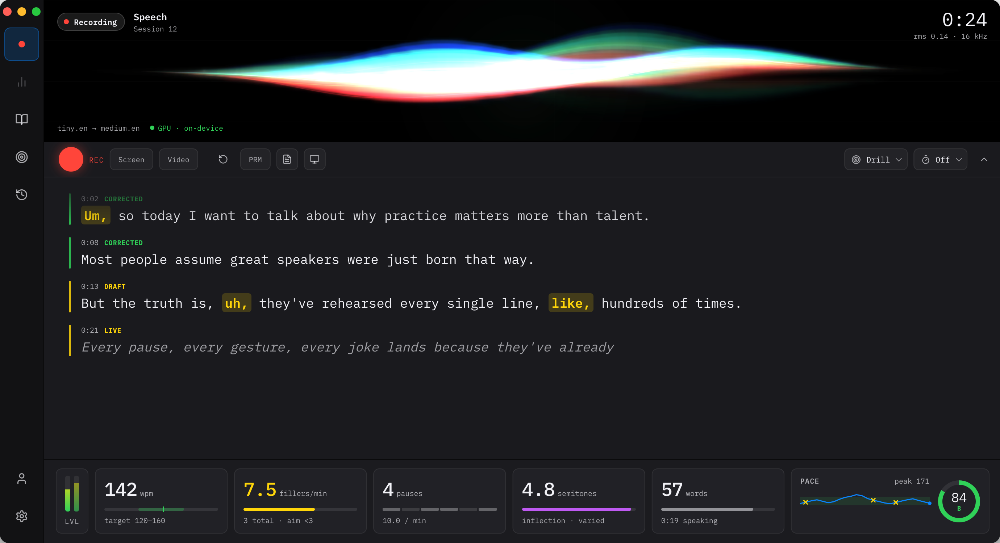
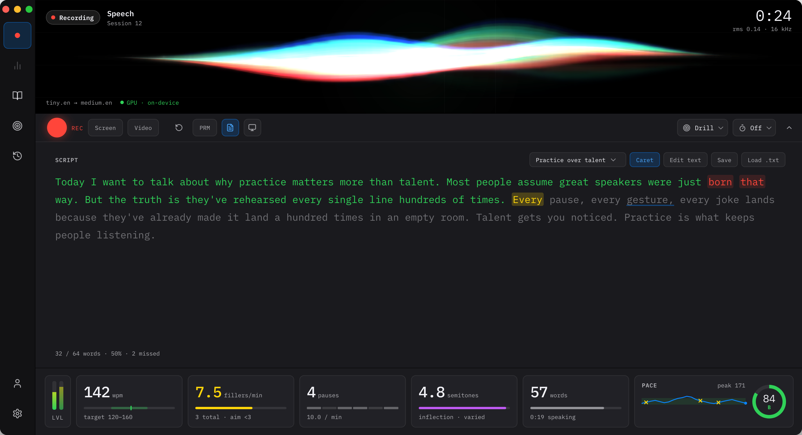
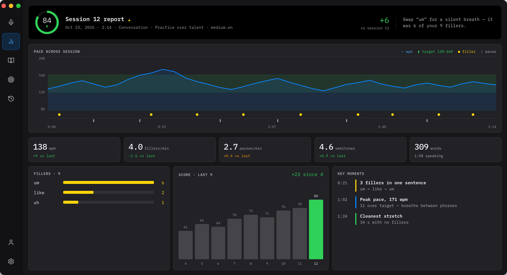

<p align="center">
  
</p>

<h1 align="center">Speech</h1>

<p align="center">
  A local speech-fluency trainer<br>
  <a href="https://github.com/MarsonTagawa/speech/releases/latest">Download</a> ·
  <a href="#install">Install</a> ·
  <a href="#develop">Develop</a>
</p>

Speak, and Speech transcribes you live, flags filler words, and scores your
pace, pauses and delivery. It runs entirely on-device: no audio ever leaves
your machine.



Demo Video: <https://youtu.be/3KGP_7Rvy60?si=7YgsJYu72BsbGU6Y>

## Features

- **Live transcription.** A fast tiny.en model shows text as you speak; a
  slower medium.en model re-decodes in the background and quietly corrects
  each finished line.
- **Filler detection.** Hesitations (`um`, `uh`) are always flagged. Ambiguous
  words (`so`, `like`, `you know`) are checked one by one with an offline
  part-of-speech tagger, so real fillers get caught and normal usage doesn't.
- **Delivery metrics.** Words per minute over voiced time, hesitation pauses,
  loudness, and pitch (median, inflection range, uptalk).
- **Speeches.** Save scripts and read along while you talk. Each speech tracks
  your attempts and quotes the sentences you skip most. Optional countdown
  timer.

  

- **History.** Every session is saved locally with its full report. A profile
  shows progress over time, personal bests and streaks.

  

- **Model choice.** Pick the live and correction models in Settings, from
  tiny.en up to large-v3-turbo. Models that aren't bundled download on demand
  from Hugging Face.

Built with Tauri (Rust) and vanilla TypeScript, using whisper.cpp for
transcription and Silero VAD for voice detection.

## Install

Downloads are on the [latest release](https://github.com/MarsonTagawa/speech/releases/latest).
The speech models are bundled.

### Linux

Needs x86_64 with glibc 2.38 or newer (Ubuntu 24.04+, Fedora 39+, Debian 13+).

```sh
chmod +x Speech_*_amd64.AppImage
./Speech_*_amd64.AppImage
```

### macOS

Needs Apple Silicon and macOS 13.4 or newer. Download
`Speech_*_aarch64.app.tar.gz` and unpack it into Applications:

```sh
tar -xzf ~/Downloads/Speech_*_aarch64.app.tar.gz -C /Applications
xattr -dr com.apple.quarantine /Applications/Speech.app
```

The app isn't signed with an Apple developer ID. Without the `xattr` line,
macOS reports it as damaged and won't open it. On an Intel Mac,
[build from source](#from-source).

### Windows

Needs 64-bit Windows 10 or 11. Download and run [Speech_*_x64-setup.exe](https://github.com/MarsonTagawa/speech/releases/download/v0.2.2/Speech_0.2.2_x64-setup.exe). It
isn't code-signed, so SmartScreen warns first: click **More info**, then
**Run anyway**.

### From source

One command installs the build tools, fetches the models, builds the app and
installs it.

macOS and Linux:

```sh
git clone https://github.com/MarsonTagawa/speech && cd speech && scripts/install.sh --install-deps
```

Windows (PowerShell):

```powershell
git clone https://github.com/MarsonTagawa/speech; cd speech; powershell -ExecutionPolicy Bypass -File scripts\install.ps1 -InstallDeps
```
| Option | Effect |
| --- | --- |
| `--install-deps` / `-InstallDeps` | Install missing build tools first: Homebrew (plus Xcode Command Line Tools) on macOS, apt/dnf/pacman on Linux (asks for sudo), winget on Windows. Rust comes from rustup. Leave it off to only build. |
| `--no-medium` | Skip the 539 MB correction model. You can download it from Settings later. |
| `--models-only` | Only fetch the models, for [development](#develop). |

To install the dependencies yourself instead:

- [Rust](https://rustup.rs) and [Bun](https://bun.sh)
- Tauri's [platform prerequisites](https://v2.tauri.app/start/prerequisites/)
  (Xcode Command Line Tools on macOS, MSVC build tools and WebView2 on Windows,
  WebKitGTK and friends on Linux)
- CMake and Clang, to build whisper.cpp
- On Linux and Windows, the [Vulkan SDK](https://vulkan.lunarg.com/sdk/home)
  (headers, loader and `glslc`) for whisper.cpp's GPU backend

On NixOS, `nix develop` provides everything except Rust and Bun.

**Windows path length.** whisper.cpp's Vulkan build overflows Windows'
260-character path limit, so the script turns on long-path support (one admin
prompt) and builds in `C:\sb`. For `bun run tauri dev`, set
`$env:CARGO_TARGET_DIR = "C:\sb"` first.

**Portable Linux builds.** A Linux build links against the host's libraries, and
one made on NixOS only runs on NixOS. To build packages that run on other
distros, use `scripts/build-linux.sh`, which builds inside Ubuntu 24.04 with
Docker (output in `src-tauri/target/docker/release/bundle/`).

## Develop

```sh
scripts/install.sh --models-only
bun install
bun run tauri dev
```

`bun run tauri build` makes every bundle format (`.dmg`, `.msi`, `.deb`, `.rpm`,
…) in `src-tauri/target/release/bundle/`.

### Models

The model weights are large, so they're gitignored. Anything in
`src-tauri/resources/` is bundled into the app, and `--models-only` fetches them
all there. To fetch them by hand:

```sh
cd src-tauri/resources
curl -L -O https://huggingface.co/ggerganov/whisper.cpp/resolve/main/ggml-tiny.en-q5_1.bin
curl -L -o silero_vad.onnx https://github.com/snakers4/silero-vad/raw/master/src/silero_vad/data/silero_vad.onnx
# optional: default correction model; otherwise download it from Settings
curl -L -O https://huggingface.co/ggerganov/whisper.cpp/resolve/main/ggml-medium.en-q5_0.bin
```

tiny.en and the VAD are required. Models downloaded from Settings go to
`<app data>/models/`. All whisper models run on the GPU. The live model is
warmed up at launch; the correction model is loaded for each pass and freed
when it's done.

### Camera models

The camera's presence grading is optional. It runs MediaPipe's face, pose and
hand models in Rust as ONNX. The install scripts download them, already
converted, from the
[vision-models-1](https://github.com/MarsonTagawa/speech/releases/tag/vision-models-1)
release. By hand:

```sh
cd src-tauri/resources
curl -L -O https://github.com/MarsonTagawa/speech/releases/download/vision-models-1/vision-models.zip
unzip vision-models.zip -d vision && rm vision-models.zip
```

To convert them yourself (needs Nix, which it uses to run `uv`; the first run
downloads about 250 MB of TensorFlow into `src-tauri/target/vision-convert/`):

```sh
scripts/convert-vision-models.sh            # models → src-tauri/resources/vision/
scripts/convert-vision-models.sh --goldens  # + golden test data for `cargo test -- --ignored`
```

Without them, the Video toggle reports "Camera models missing" and the app
works audio-only.

## Release

Pushing a `v*` tag runs `.github/workflows/release.yml`. It builds the
AppImage, the macOS app and the Windows installer, signs them for the updater,
and drafts a GitHub release with a `latest.json`.

1. Bump `version` in `src-tauri/tauri.conf.json`. The workflow checks that the
   tag matches.
2. Tag and push:

   ```sh
   git tag v0.2.0 && git push origin v0.2.0
   ```

3. Publish the draft when it looks right. Installed apps see the update from
   then on.

The workflow signs with the `TAURI_SIGNING_PRIVATE_KEY` repo secret, the
private half of `plugins.updater.pubkey` in `tauri.conf.json`. If that key is
lost, installed apps can't update anymore. Releases that aren't app versions,
like the camera models, must not be marked latest, or the updater stops
finding `latest.json`.
